# Walkthrough: one photograph, many prints

This walkthrough follows a single photograph through the panel: visualize, predict, reveal, interpret, and the opportunities sheet. At each step it shows what a setting does to the photograph's **zone distribution**, the share of the frame that falls in each zone from 0 to X. That's what you previsualize when you plan a drawing or a print.

Every figure and number here was produced by the plugin's own code running in Photoshop 2026 on this photograph. Nothing is mocked up. To rebuild them after changing the plugin, see [Regenerating the figures](#regenerating-the-figures).

## The scene

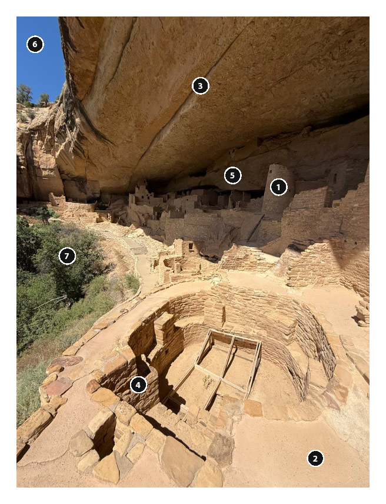

A cliff dwelling under a sandstone overhang, in hard midday sun. It's a demanding scene:

- direct sun on pale stone in the foreground;
- deep shade inside the alcove;
- the underside of the overhang, lit only by light bouncing up from the sunlit floor;
- a small piece of blue sky and some green foliage, which react strongly to filters.

The numbered circles are Color Sampler markers. The panel numbers them in the order you place them.

## 1. Visualize

Before measuring anything, write the print you want. An example for this scene:

> *The overhang as a heavy lid of stone pressing down on a sunlit village; the plaza glowing, but every block still readable.*

Then choose the print's key. The panel's advice depends on that choice. Here is what it says about this scene for each one (quoted from the Reveal step):

| The print you want | What the panel suggests |
|---|---|
| Low key | Only 50% of the frame is dark. A low-key print wants most of it in Zones 0–IV: place your shadow anchor a zone lower, burn the edges, and darken the sky (red filter if it is blue). |
| Full scale | The scene already supports the print you visualized. Now decide where to spend separation: compress what doesn't matter, expand what does. |
| High key | Only 43% of the frame is light. For a high-key print, place your shadow anchor on Zone IV or V so the whole scale lifts, and use N−1 to keep the highlights textured. |

## 2. Predict: place your anchors

With the Color Sampler tool, mark the shadow that must keep its texture (#1) and the brightest light that must keep its texture (#2), then any other spots you're curious about. In training mode you'd guess each zone now, before seeing any of the readings below.

| Marker | What it is | Meter reading |
|---|---|---|
| **#1** shadow anchor | The round tower, in the alcove's shade | Zone **III** (3.2), L\* 32 |
| **#2** light anchor | Sunlit plaza stone | Zone **VIII** (7.9), L\* 79 |
| #3 | The overhang's underside, lit from below | Zone IV (3.8) |
| #4 | Shaded wall of the kiva | Zone V (5.5) |
| #5 | Deep shade at the back of the alcove | Zone II (1.8) |
| #6 | Blue sky | Zone V (5.1) |
| #7 | Foliage | Zone IV (3.9) |

Three of these readings commonly surprise people:

- **The kiva wall (#4) looks like shadow but reads Zone V.** Light reflected from the sunlit floor fills it. This is an *open* shadow, a full two zones lighter than the tower's.
- **The blue sky (#6) is middle grey.** A blue sky has strong colour but only middle brightness. Without a filter it won't separate from stone of the same brightness.
- **Only the back of the alcove (#5) reaches Zone II,** the last zone that still shows texture. Anything darker would print as solid black.

## 3. Reveal: what the meter says

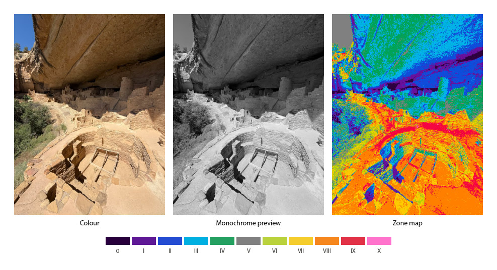

The zone map shows the photograph as two lights: the alcove's shade in blues and greens (Zones II–IV) and the sun in oranges (Zones VII–VIII). The brightest stone breaks into red (Zone IX).


| Reading | As metered |
|---|---|
| Key | Middle key: 50% of the frame in Zones 0–IV |
| Range | Full scale: true black and paper white both present |
| Textured darks (II–III) | 27% |
| Textured lights (VII–VIII) | 32% |
| Middle (IV–VI) | 28% |
| No texture (0–I, IX–X) | 13% |

The distribution has two peaks: shade at Zones III–IV (about 16% each) and sun at Zone VIII (23%). The middle zones, V and VI, are thin. There is little mud here: the scene is already built from two masses.

### Reading the overlays

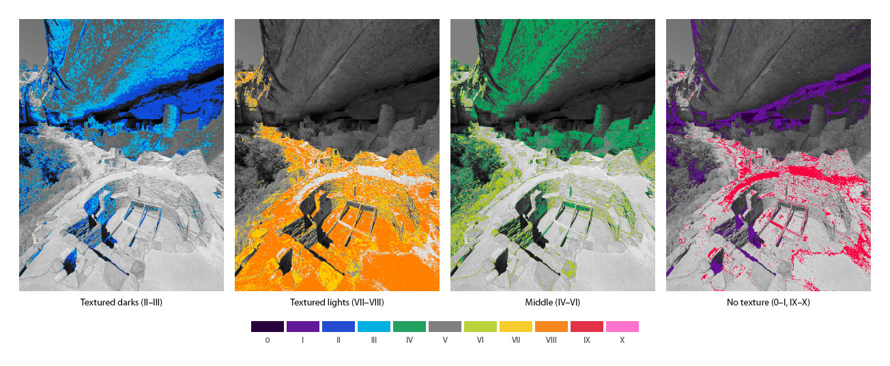

- **Textured darks (II–III)** cover the overhang's shaded underside and the alcove. That's where crosshatching has to keep paper flecks alive.
- **Textured lights (VII–VIII)** cover almost the whole sunlit floor. Lose these zones and the stone becomes glare.
- **Middle (IV–VI)** is mostly the overhang's bounce-lit ceiling, the one large area at risk of reading flat.
- **No texture** shows the solid blacks at the back of the alcove and the sunlit edges that have already burned out to Zone IX.

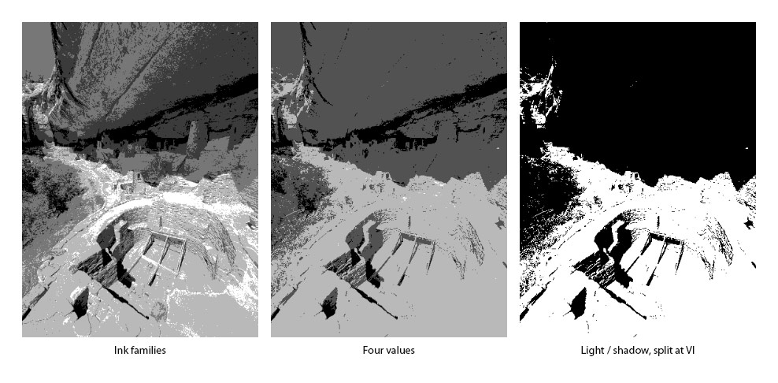

The **light/shadow** split at Zone VI shows the picture's design in two values: a dark lid over a light floor. If that two-value version doesn't carry the drama, no amount of rendering will add it. **Four values** and **ink families** show how many distinct mark families the drawing will need, and where each one goes.

## 4. Interpret: perform the score

### Filters

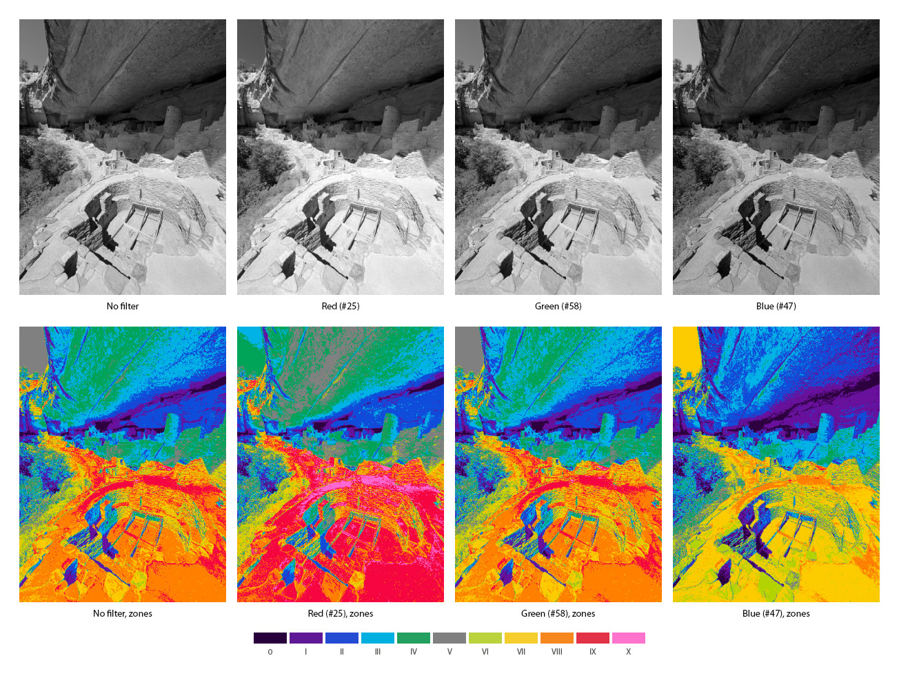


A filter changes local colour into tone, so its effect depends on which colours dominate the scene. Here the subject is **warm sandstone**. That reverses the usual expectation that a red filter is "the dramatic one":

| Filter | Dark (0–IV) | Textured lights | No texture | Range |
|---|---|---|---|---|
| No filter | 50% | 33% | 13% | Full scale |
| Yellow (#8) | 49% | 28% | 17% | Full scale |
| Orange (#21) | 48% | 22% | 23% | Full scale |
| Red (#25) | 41% | 14% | 31% | Full scale |
| Deep red (#29) | 35% | 10% | 36% | Full scale |
| Green (#58) | 50% | 33% | 13% | Full scale |
| Blue (#47) | 54% | 28% | 17% | No paper white |

- **Red lightens this scene.** It darkens the small sky, but it lifts the warm stone so that a quarter of the frame lands in Zone IX and the floor loses its texture.
- **Blue darkens the stone.** The floor drops to Zone VII, the shade deepens, and nothing reaches paper white. The result is moody, but it has no sparkle.
- **Green barely changes anything,** because the foliage is a small part of the frame.

### Development

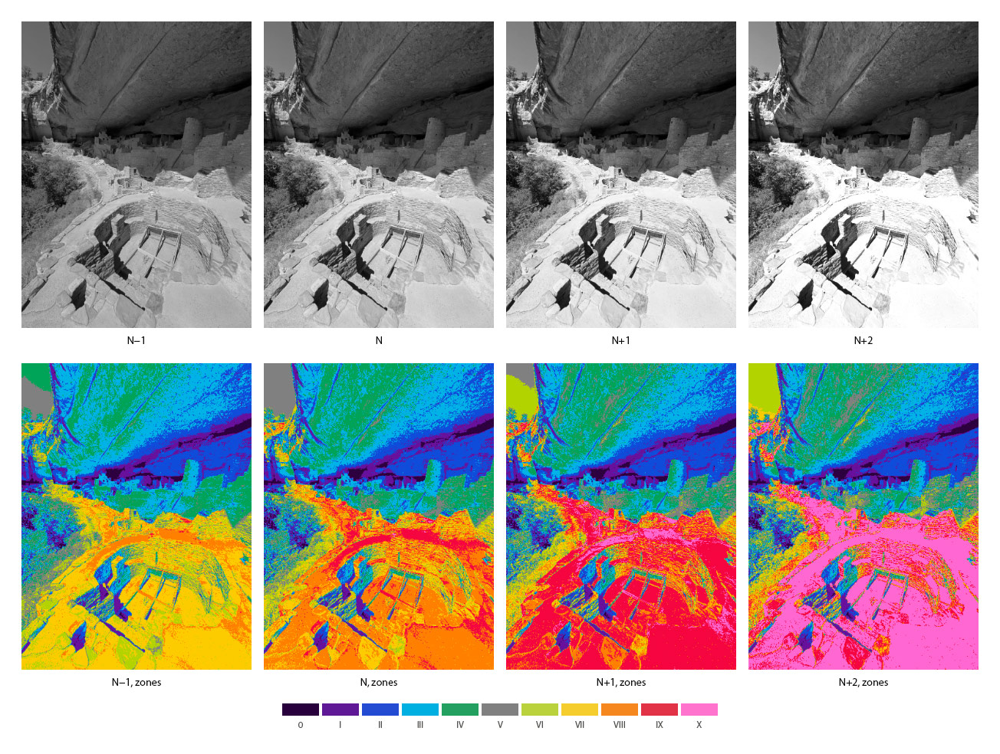


Development holds Zone III and moves the highlights. The shade columns stay put while the sunlit peak walks from Zone VII (N−1) through VIII and IX to X (N+2).

| Development | Dark (0–IV) | Textured lights | No texture | Range |
|---|---|---|---|---|
| N−1 | 54% | 29% | 7% | No paper white |
| N | 50% | 33% | 13% | Full scale |
| N+1 | 47% | 12% | 36% | Full scale |
| N+2 | 45% | 7% | 44% | Full scale |

N+1 looks brighter and more dramatic, but it pushes the plaza past Zone VIII: textured lights fall from 33% to 12%. N−1 keeps texture almost everywhere (only 7% has none) at the cost of any true white.

### Placement

Placement is Adams's method in one move. Put one marker on the zone you want, let a second fall where you want it, and the panel reports the exposure change and development you've chosen.

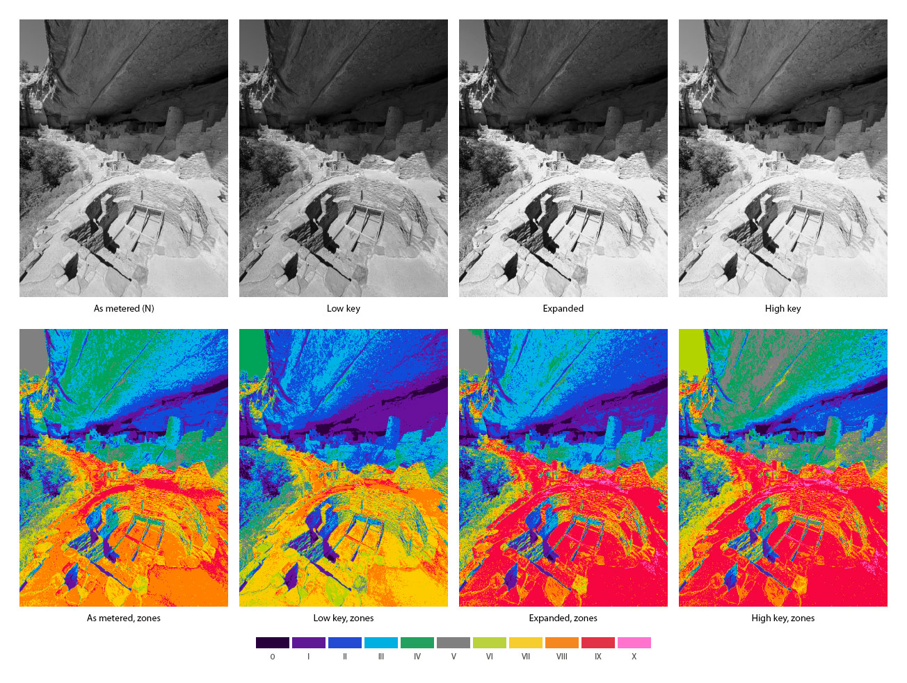


| Print | Placement | The panel reports | Dark (0–IV) | Middle (IV–VI) | Textured lights |
|---|---|---|---|---|---|
| As metered | none | | 50% | 27% | 33% |
| **Low key** | Tower (#1) on II, plaza (#2) falls on VII | placement −1.2 zones (about 1.2 stops less exposure), N+0.3 | 57% | 19% | 29% |
| **Expanded** | Overhang (#3) on III, plaza (#2) falls on IX | placement −0.8 zone, N+1.9 | 52% | 14% | 12% |
| **High key** | Tower (#1) on IV, plaza (#2) falls on IX | placement +0.8 zone, N+0.3 | 38% | 34% | 13% |

- **Low key** moves every value down a zone and keeps the floor textured, but it reaches only 57% dark, short of the 60% the panel calls low key. The sunlit floor is simply most of this frame, which is why the panel's low-key suggestion also asks for burning.
- **Expanded** separates the overhang from the plaza most strongly and has the least mud of any placement (14%), but the plaza goes to Zone IX.
- **High key** lifts the shade into Zones IV–VI, a third of the frame (34%). It reads as open and airy.

### Burning

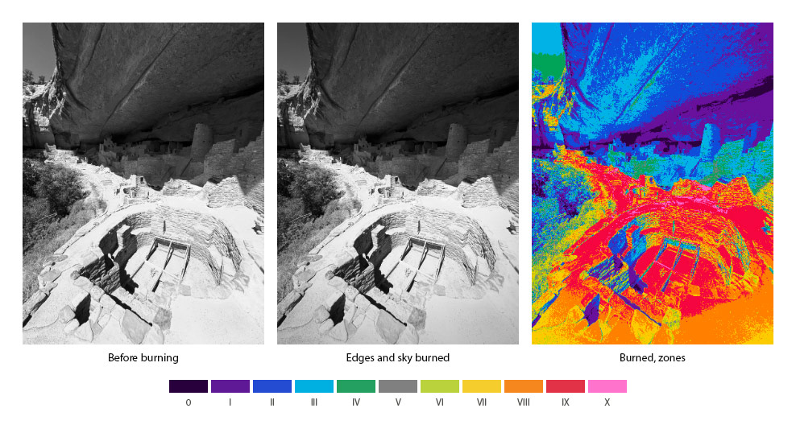

Adams burned skies and print edges on nearly every print. Here, burning the edges and sky at 70% on the **Expanded** print:

- **brings the plaza's texture back:** textured lights rise from 12% to 23%, and the edges of the floor return from Zone IX to VIII;
- **holds the eye in the village:** the frame's corners darken, so the bright centre reads as light;
- **deepens the lid:** dark share rises from 52% to 54%.

## 5. Opportunities: see them all at once

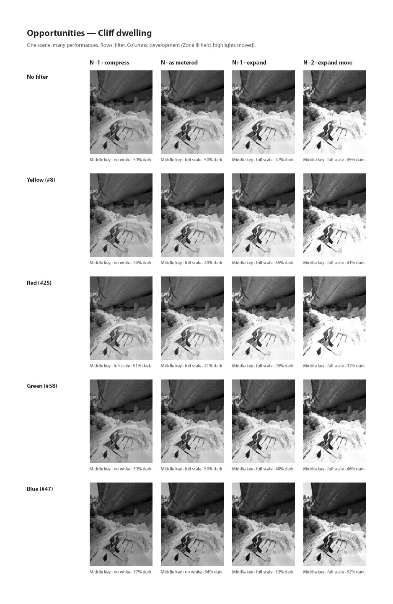

The sheet renders every combination of five filters and four developments, each captioned with its key, range and dark share. Read across a row to see what development does under one filter. Read down a column to see what the filters do at one development. Look for the version that matches your sentence, and for the one that surprises you.

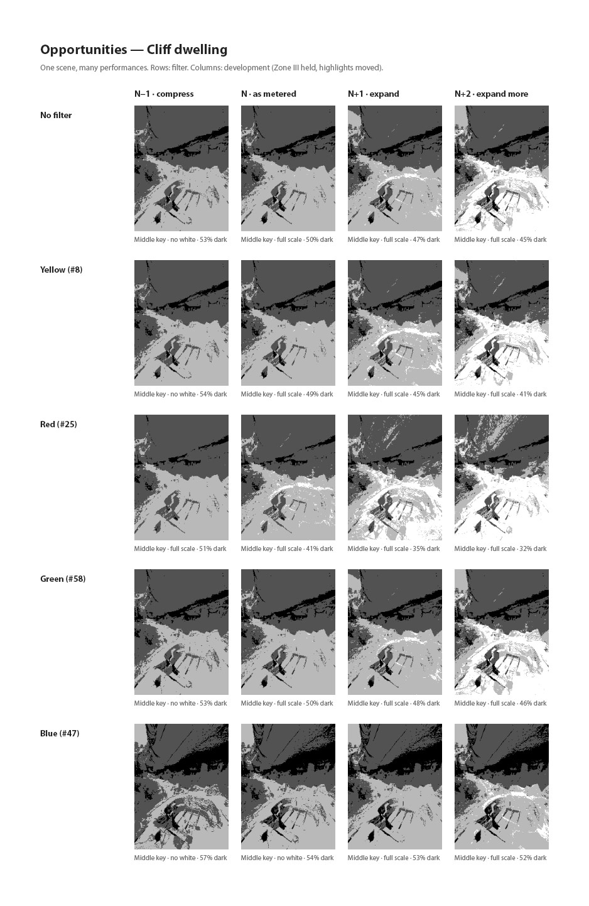

With **Show each as four value masses** ticked, each version is reduced to black, shadow, light and paper. That shows its design rather than its detail. The captions still describe the full print.

## Choosing a print

Four visualizations this scene supports, with the settings that get there and what the meter says they produce:

| Visualization | Settings | Result |
|---|---|---|
| *As found: two lights, every block readable* | No filter, N | Middle key, 50% dark, full scale, 33% textured lights |
| *A lid of stone over a glowing village* | Expanded placement, edges and sky burned 70% | 54% dark, the least mud (12%), plaza texture recovered (23%) |
| *Quiet and tactile, all texture* | N−1 | 54% dark, only 7% without texture, no paper white |
| *Open, sunlit, airy* | High key placement | 38% dark, the shade lifted into the middle zones |

For pen and ink, each version also tells you how much of the drawing is dense crosshatching and how much is open paper. Compare the light/shadow and four-value overlays of the version you choose with the [ink-coverage table](TRAINING.md#the-ink-translation) before you draw.

## Regenerating the figures

All figures, measurements and charts come from one command:

```bash
tools/make-walkthrough.sh
```

It needs macOS with Photoshop 2026 running. It works on a copy of [`images/walkthrough/source.jpg`](images/walkthrough/source.jpg). The markers, placements and burns live in [`tools/walkthrough.config.json`](../tools/walkthrough.config.json). It writes:

- the figures to `docs/images/walkthrough/`;
- the raw readings to [`measurements.json`](images/walkthrough/measurements.json);
- the zone charts (SVG) through `tools/make-zone-charts.js`.

It closes only the documents it created. If one of your own documents has the working title "Cliff dwelling", it stops rather than touch it. To walk through your own photograph, pass its path and adjust the config's markers.

Photograph supplied by the repository owner.
